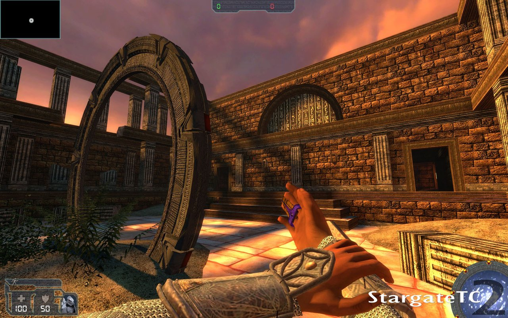
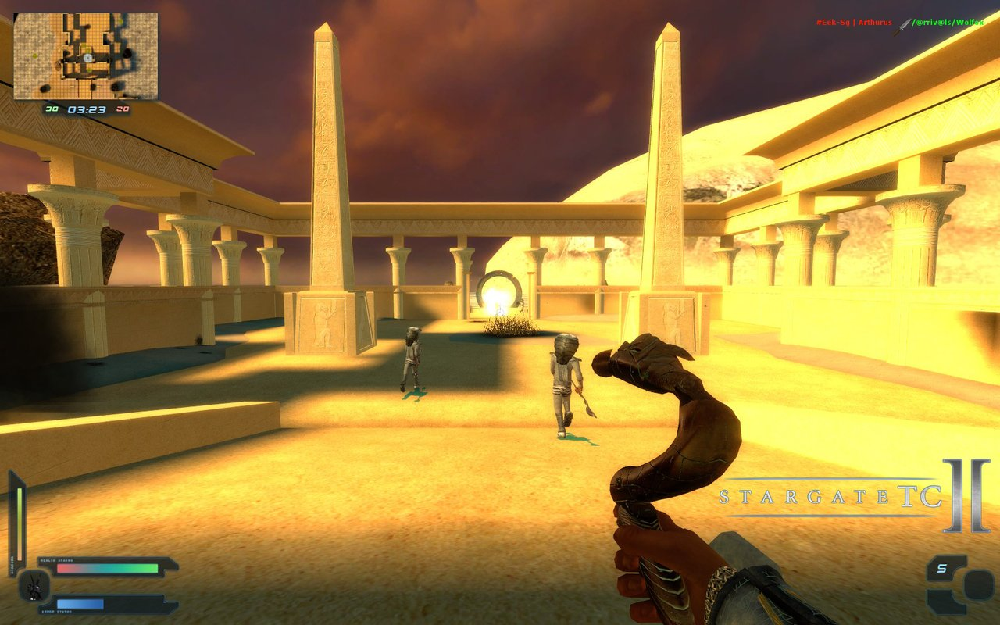
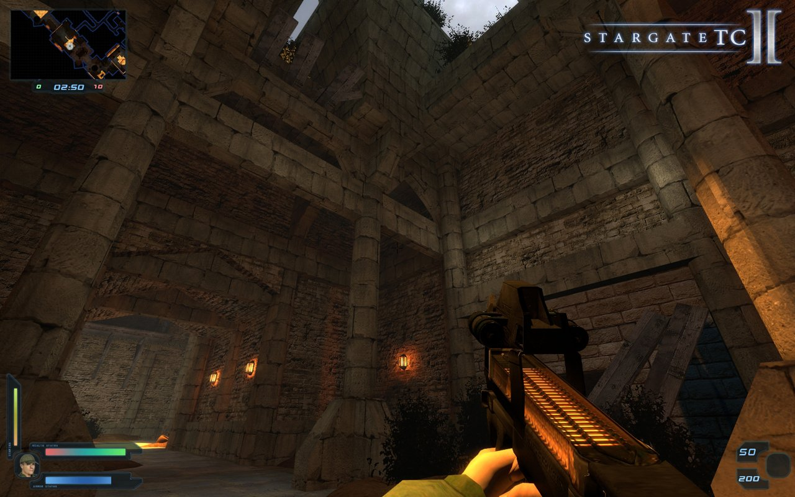

# StargateTC 2: Redial

 **[English](#english)** &nbsp;·&nbsp;  **[Français](#francais)**

 Bots for StargateTC 2, and a server browser that finds servers again. Part of **[Stargate Redial](https://github.com/Stargate-Redial)**.

 Des bots pour StargateTC 2, et un navigateur de serveurs qui retrouve les serveurs. Fait partie de **[Stargate Redial](https://github.com/Stargate-Redial)**.

| | | |
|---|---|---|
|  |  |  |

**Discord:** [discord.com/invite/SgHPP4mZyB](https://discord.com/invite/SgHPP4mZyB) &nbsp;·&nbsp; **24/7 server:** `connect 92.222.243.147:27032`

---

##  English

An unofficial add-on for **StargateTC 2** (Beta 1, 2008), the Stargate SG-1 mod for Half-Life 2:

- **It adds bots** that dial the gates at the DHD, go through, play the objectives and bring back the artefact.
- **It fixes the in-game server browser.** Out of the box, its Internet tab never lists any server.
- The main menu says "Redial V1.0.0".

*Made with love by [@CreepyInpu](https://x.com/CreepyInpu).*

### Quick start

1. Install **Source SDK Base 2006** from Steam: in your Library, under Tools, or press Win+R and run `steam://install/215`.
2. Install **StargateTC 2 Beta 1** ([ModDB](https://www.moddb.com/mods/stargatetc-2/downloads/stargatetc-2-beta-1-full-exe)), then its **patch 1** ([ModDB](https://www.moddb.com/mods/stargatetc-2/downloads/stargatetc2-patch-1-for-beta-1)). The mod goes into `Steam\steamapps\sourcemods\stargatetc2`.
3. Download **`stargatetc2-redial-v1.0.0.zip`** from [Releases](../../releases), extract it anywhere and double-click **`install.bat`**.
4. Restart Steam and launch **StargateTC 2**. Then either:
   - **Create Server**: bots join and fill the game up to 10 players;
   - or join the 24/7 server: **Find Servers > Internet**, or `connect 92.222.243.147:27032` in the console.

### Installation details

- **The installer** finds Steam, the mod and Source SDK Base by itself. It backs up every file it replaces in a `redial-backup` folder, and you can run it again safely. Options:
  - `install.bat -ModDir "<path>\steamapps\sourcemods\stargatetc2"` if the mod isn't found;
  - `install.bat -SdkBaseDir "<path>\steamapps\common\Source SDK Base"` if Source SDK Base isn't found;
  - `install.bat -NoServerBrowserFix` to leave Source SDK Base untouched;
  - `install.bat -NoSplash` to keep the mod's own menu background.
- **To uninstall,** run **`uninstall.bat`**. Add `-KeepServerBrowserFix` to remove only the bots.
- **What the installer changes,** and how to do it by hand: [docs/DETAILS.md](docs/DETAILS.md).

### The server browser fix

StargateTC 2 runs on Source SDK Base 2006. Its server browser still asks Valve's old master servers for the server list, and they answer with an empty list. So the Internet tab stays on "Getting new server list…", for every server, ours included.

The fix comes from [sg-servers.net](https://fastdl.sg-servers.net/downloads/stargate_tc2/serverBrowser-fix/), who host StargateTC 2 servers too. It replaces the browser with one that asks Steam directly, as recent Source games do. A copy is kept in [`server-browser-fix/`](server-browser-fix/) in case the original download goes away, and the installer puts it into Source SDK Base. What it contains: [server-browser-fix/README.md](server-browser-fix/README.md).

It changes Source SDK Base 2006 itself, so other mods on it get a working browser too. Steam's "Verify integrity of game files" on Source SDK Base 2006 puts the original files back.

### Play online

A server runs 24/7 with bots, so there's always a match: `connect 92.222.243.147:27032`. Bots leave as players join. Come and say hello on the [Discord](https://discord.com/invite/SgHPP4mZyB).

### Controlling the bots

Bots join by themselves and pick a class in the team with fewer players. Each class has its fixed weapon pack. The settings are in a block at the end of `cfg\server.cfg`.

| Console command | Effect |
|---|---|
| `botrix config bot quota 12` | total of players + bots to keep (0 = no automatic bots) |
| `botrix config bot intelligence normal pro` | skill range: fool, stupied, normal, smart, pro |
| `botrix bot add` | add a bot |
| `botrix bot kick all` | remove every bot |
| `botrix bot` | list the bot commands |
| `sgtc2_objectives` | what the bots know about the map: gates, DHD, objectives, artefact |

A map can have its own total in `cfg\botrix_<map>.cfg`, e.g. `cfg\botrix_sg2_sanctuary.cfg` (14 players).

The installer also sets `sgtc2_respawn 1`, an option of the mod ("Respawn Mode" in Create Server): the dead come back in waves during the round, so you can join a round in progress.

### Maps

| Map | Mode | Bots |
|---|---|---|
| sg2_temple | Objective | The Tau'ri dial P2X-BFL at the DHD, go through the gate and reach the objective; the Goa'uld guard the DHD and the gate. |
| obj_iced_pilak | Objective | The Tau'ri dial and go through the gate. The map's objective never triggers, so rounds end on time. |
| ah_forest | Artefact capture | Bots pick up the artefact, dial their base at the DHD, step aside from the kawoosh and go through. They avoid the turrets. |
| sg2_sanctuary | Team deathmatch | Bots fight all over the map. |

Other maps have no waypoints: the bots won't move there.

### If something goes wrong

- **There are no bots:** type `plugin_print` in the console. Botrix should be listed. If not, run `install.bat` again and read its output.
- **The Internet tab is empty again:** a Steam update or file check put back the original browser. Run `install.bat` again.
- **The installer can't find the mod or Source SDK Base:** pass `-ModDir` / `-SdkBaseDir` (see above).

---

##  Français

Un ajout non officiel pour **StargateTC 2** (Beta 1, 2008), le mod Stargate SG-1 de Half-Life 2 :

- **il ajoute des bots** qui composent les portes au DHD, les traversent, jouent les objectifs et rapportent l'artefact ;
- **il répare le navigateur de serveurs du jeu** : d'origine, son onglet Internet n'affiche jamais aucun serveur ;
- le menu principal affiche « Redial V1.0.0 ».

*Fait avec amour par [@CreepyInpu](https://x.com/CreepyInpu).*

### Démarrage rapide

1. Installez **Source SDK Base 2006** depuis Steam : dans votre bibliothèque, rubrique Outils, ou avec Win+R puis `steam://install/215`.
2. Installez **StargateTC 2 Beta 1** ([ModDB](https://www.moddb.com/mods/stargatetc-2/downloads/stargatetc-2-beta-1-full-exe)), puis son **patch 1** ([ModDB](https://www.moddb.com/mods/stargatetc-2/downloads/stargatetc2-patch-1-for-beta-1)). Le mod va dans `Steam\steamapps\sourcemods\stargatetc2`.
3. Téléchargez **`stargatetc2-redial-v1.0.0.zip`** dans les [Releases](../../releases), extrayez-le n'importe où, puis double-cliquez sur **`install.bat`**.
4. Redémarrez Steam et lancez **StargateTC 2**. Ensuite :
   - **Create Server** : des bots rejoignent la partie et la complètent jusqu'à 10 joueurs ;
   - ou rejoignez le serveur 24/7 : **Find Servers > Internet**, ou `connect 92.222.243.147:27032` dans la console.

### Détails d'installation

- **L'installeur** trouve Steam, le mod et Source SDK Base tout seul. Il sauvegarde chaque fichier qu'il remplace dans un dossier `redial-backup`, et on peut le relancer sans risque. Options :
  - `install.bat -ModDir "<chemin>\steamapps\sourcemods\stargatetc2"` si le mod n'est pas trouvé ;
  - `install.bat -SdkBaseDir "<chemin>\steamapps\common\Source SDK Base"` si Source SDK Base n'est pas trouvé ;
  - `install.bat -NoServerBrowserFix` pour ne pas toucher à Source SDK Base ;
  - `install.bat -NoSplash` pour garder le fond de menu d'origine du mod.
- **Pour désinstaller,** lancez **`uninstall.bat`**. Ajoutez `-KeepServerBrowserFix` pour ne retirer que les bots.
- **Ce que l'installeur modifie,** et comment le faire à la main : [docs/DETAILS.md](docs/DETAILS.md) (en anglais).

### Le correctif du navigateur de serveurs

StargateTC 2 tourne sur Source SDK Base 2006. Son navigateur de serveurs demande toujours la liste aux anciens serveurs maîtres de Valve, qui répondent par une liste vide. L'onglet Internet reste donc sur « Getting new server list… », pour tous les serveurs, le nôtre compris.

Le correctif vient de [sg-servers.net](https://fastdl.sg-servers.net/downloads/stargate_tc2/serverBrowser-fix/), qui héberge aussi des serveurs StargateTC 2. Il remplace le navigateur par un autre qui interroge Steam directement, comme les jeux Source récents. Une copie est gardée dans [`server-browser-fix/`](server-browser-fix/) au cas où le téléchargement d'origine disparaîtrait, et l'installeur la pose dans Source SDK Base. Son contenu : [server-browser-fix/README.md](server-browser-fix/README.md) (en anglais).

Il modifie Source SDK Base 2006 lui-même : les autres mods qui tournent dessus retrouvent aussi un navigateur qui marche. « Vérifier l'intégrité des fichiers » de Source SDK Base 2006 dans Steam remet les fichiers d'origine.

### Jouer en ligne

Un serveur tourne 24h/24 avec des bots, donc il y a toujours une partie : `connect 92.222.243.147:27032`. Les bots cèdent leur place aux joueurs. Venez dire bonjour sur le [Discord](https://discord.com/invite/SgHPP4mZyB).

### Contrôler les bots

Les bots arrivent seuls et prennent une classe dans l'équipe la moins remplie. Chaque classe a son pack d'armes fixe. Les réglages sont dans un bloc à la fin de `cfg\server.cfg`.

| Commande console | Effet |
|---|---|
| `botrix config bot quota 12` | total de joueurs + bots à maintenir (0 = pas de bots automatiques) |
| `botrix config bot intelligence normal pro` | niveaux des bots : fool, stupied, normal, smart, pro |
| `botrix bot add` | ajoute un bot |
| `botrix bot kick all` | retire tous les bots |
| `botrix bot` | liste les commandes des bots |
| `sgtc2_objectives` | ce que les bots savent de la carte : portes, DHD, objectifs, artefact |

Une carte peut avoir son propre total dans `cfg\botrix_<carte>.cfg`, par exemple `cfg\botrix_sg2_sanctuary.cfg` (14 joueurs).

L'installeur règle aussi `sgtc2_respawn 1`, une option du mod (« Respawn Mode » dans Create Server) : les morts reviennent par vagues pendant la manche, donc on peut rejoindre une manche en cours.

### Cartes

| Carte | Mode | Bots |
|---|---|---|
| sg2_temple | Objectif | Les Tau'ri composent P2X-BFL au DHD, passent la porte et atteignent l'objectif ; les Goa'uld gardent le DHD et la porte. |
| obj_iced_pilak | Objectif | Les Tau'ri composent et passent la porte. L'objectif de la carte ne se déclenche jamais, donc les manches finissent au temps. |
| ah_forest | Capture de l'artefact | Les bots ramassent l'artefact, composent leur base au DHD, s'écartent du kawoosh et passent la porte. Ils évitent les tourelles. |
| sg2_sanctuary | Match à mort par équipe | Les bots se battent dans toute la carte. |

Les autres cartes n'ont pas de waypoints : les bots n'y bougeront pas.

### En cas de problème

- **Pas de bots :** tapez `plugin_print` dans la console. Botrix doit apparaître. Sinon, relancez `install.bat` et lisez ce qu'il affiche.
- **L'onglet Internet est de nouveau vide :** une mise à jour ou une vérification de Steam a remis le navigateur d'origine. Relancez `install.bat`.
- **L'installeur ne trouve pas le mod ou Source SDK Base :** passez `-ModDir` / `-SdkBaseDir` (voir plus haut).

---

## Stargate Redial

Stargate mods brought back to life, with bots and a server running 24/7 · Les mods Stargate qui reprennent vie, avec des bots et un serveur 24h/24:

| Project | Game | 24/7 server |
|---|---|---|
| [StargateTC: Redial](https://github.com/Stargate-Redial/stargatetc-redial) | StargateTC 2.0 (Half-Life) | `connect 92.222.243.147:27030` |
| **StargateTC 2: Redial** | StargateTC 2 (Source SDK Base 2006) | `connect 92.222.243.147:27032` |
| [Stargate TLS: Redial](https://github.com/Stargate-Redial/stargatetls-redial) | Stargate: The Last Stand (Source SDK Base 2007) | `connect 92.222.243.147:27031` |

Discord: [discord.com/invite/SgHPP4mZyB](https://discord.com/invite/SgHPP4mZyB)

## Credits

- **StargateTC 2: Redial:** [@CreepyInpu](https://x.com/CreepyInpu). Bug reports go to this repository's issues.
- **StargateTC 2:** the StargateTC 2 team. The screenshots above come from the mod's [ModDB page](https://www.moddb.com/mods/stargatetc-2).
- **Botrix:** Boris Godin ([borzh/botrix](https://github.com/borzh/botrix)). The bots here are Botrix with a StargateTC 2 port: [src/](src/).
- **Server browser fix:** [sg-servers.net](https://fastdl.sg-servers.net/downloads/stargate_tc2/serverBrowser-fix/). The browser itself was rebuilt by the [Fortress Forever](https://store.steampowered.com/app/253530/Fortress_Forever/) team.
- **Source SDK Base, Half-Life 2:** Valve. **Stargate SG-1** is a trademark of MGM.

This is a fan project, not affiliated with the StargateTC 2 team, Valve or MGM. You need your own copy of the mod; this repository does not redistribute it. License: see [LICENSE](LICENSE) and [THIRD-PARTY.txt](THIRD-PARTY.txt). Building from source: [docs/BUILDING.md](docs/BUILDING.md). Hosting a Linux dedicated server: [docs/LINUX_SERVER.md](docs/LINUX_SERVER.md).
